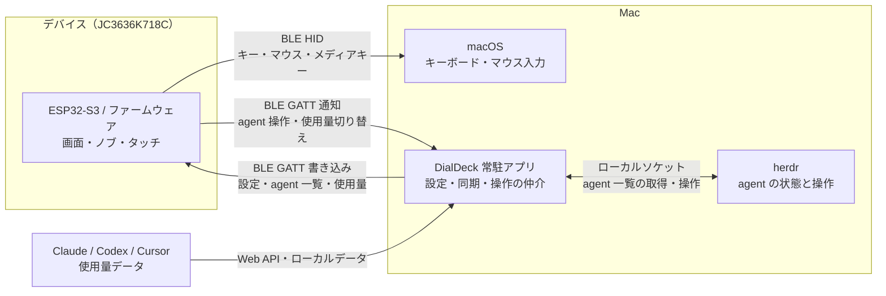

# 構成

DialDeck の実行体は二つ。デバイス上のファームウェアと、Mac のアプリ。無線は BLE だけ。Wi-Fi と OTA は無い。

## 全体図

使用量の取得元は provider によって異なる。USB は書き込み、ログ、充電に使い、通常の入力と設定の通信は BLE を通る。

## つながるもの

1. BLE HID。デバイスがキーボード、マウス、メディアキーになる。接続を持っているのは macOS で、アプリは HID を喋らない。ファームは `firmware/main/ble_hid.c`。
2. BLE の独自 GATT。アプリが、ボタンの割り当て、タッチパッドと明るさ、herdr の agent 一覧を読み書きする。バイト列は [config-protocol.md](config-protocol.md)。ファームは `firmware/main/config_service.c`、Mac は `mac/Sources/DialDeckKit/DeviceLink.swift`。
3. herdr のソケット。開くのは Mac アプリだけ（`HerdrSocket.swift`、`HerdrBridge.swift`）。デバイスは GATT の action で「この agent をフォーカスして」などと頼み、アプリが herdr に渡す。

アプリは Bluetooth をスキャンしない。ペアリング済みで、macOS が HID として接続している DialDeck を使う。

## ファームウェア

ESP-IDF v6.1。アプリは `firmware/main`。画面は `screen_def_t`（`screen.h`）で、切り替えとメニューは `ui.c`。見た目は `theme.h`、`widgets.h`、`ring.h`。

| ファイル | 役割 |
| --- | --- |
| `main.c` | 起動。タッチとノブを、HID か画面へ渡す |
| `display.c` | 液晶 ST77916、タッチ CST816、LVGL、明るさ、無操作時の液晶休止と自動 Light Sleep |
| `lcd_init_cmds.h` | 液晶の初期化列。出典は上流 v2.2.12 |
| `knob.c` | ノブの目盛り |
| `touchpad.c` | 画面をマウスにするジェスチャ |
| `ble_hid.c` | BLE HID と、今話すホストの切り替え |
| `host_slots.c` | ペアリングしたホスト。最大 3 |
| `deck_config.c`, `deck_screen.c` | ボタン 9 個。中央と、上から時計回り |
| `settings.c`, `settings_screen.c` | 左のサイドメニューで分類を選ぶ。右側でタッチパッド、スクロール、画面、Bluetooth を設定し、Battery で残量・電圧・給電状態を確認する |
| `config_service.c` | GATT |
| `agents.c`, `agents_screen.c` | Mac から受け取った agent の表示と操作。8 件ずつのページを縦スワイプかノブで送る。使用量の週次の窓は外側に出す |
| `usage.c` | Mac から受け取った agent のプランの使用量。Agents 画面の中央に出す |
| `battery.c` | 電池残量 |
| `board.h` | ピン |
| `fonts/` | 日本語フォント。`font_ja_16.c` は `firmware/tools/make-font.sh` の生成物 |

依存は `firmware/main/idf_component.yml`。LVGL 9、`esp_lcd_st77916`、`esp_lcd_touch_cst816s`、`esp_lvgl_port`。`idf.py build` が `firmware/managed_components/` に取る。

## Mac アプリ

Swift Package。macOS 14、Swift ツール 6.0、言語モード 5。Xcode のプロジェクトは無い。

| ターゲット | 役割 |
| --- | --- |
| `DialDeckKit` | GATT、ファームと同じバイト列、herdr のソケット、プランの使用量の取得（`UsageMonitor.swift`） |
| `DialDeck` | SwiftUI のメニューバー常駐アプリと設定ウィンドウ。サイドバーは Agents、Touchpad、Deck |

入口は `mac/Sources/DialDeck/DialDeckApp.swift`。メニューは `MenuContent.swift` で、接続、herdr、使用量の状態と、設定ウィンドウ、ログイン時の起動、終了を置く。ウィンドウを閉じても herdr と使用量は送り続ける。ボタンの編集は `DeckEditorView.swift`、タッチパッドと明るさは `TouchpadSettingsView.swift`。使用量を出す agent（Claude、Codex、Cursor）は `AgentsSettingsView.swift`（Agents ページ）で選ぶ。デバイスの Agents 画面の中央をタップしても次へ切り替わる。

ビルドは `mac/scripts/build-app.sh`。CoreBluetooth には Bluetooth の使用目的を書いた Info.plist が要るので、SwiftPM の実行ファイルを `.app` に包んで ad hoc 署名する。

## ビルドに入らないもの

- `.claude/skills/guition-jc3636k718c` は上流の ESPHome 向けスキルを置いただけ。ファームは ESPHome ではない。
- `references/` は出典リポジトリの clone 先。手順は [references/README.md](../references/README.md)。
- `backup/` は純正ファームの吸い出し。nvs に認証情報が入り得る。
